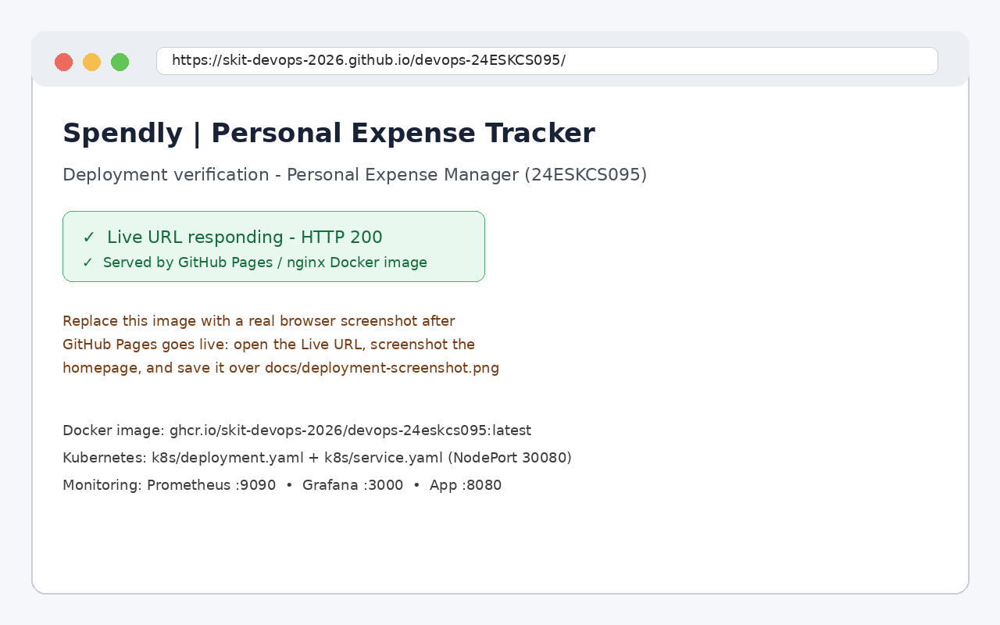

# Deployment

## Live URL
Live URL: https://skit-devops-2026.github.io/devops-24ESKCS095/

The site is deployed automatically to GitHub Pages by
`.github/workflows/deploy-pages.yml` on every push to `main`.
After merging, check: Repo > Settings > Pages (Source: GitHub Actions),
and Repo > Actions > "Deploy to GitHub Pages" must be green.
Then open the Live URL above - it should return HTTP 200.



> After Pages goes live, replace `docs/deployment-screenshot.png`
> with a real screenshot of the homepage at the Live URL and commit it.

## Docker deployment (alternative / local)
```bash
docker build -t ghcr.io/skit-devops-2026/devops-24eskcs095:latest .
docker run -d -p 8080:80 ghcr.io/skit-devops-2026/devops-24eskcs095:latest
# http://localhost:8080
# or everything, including monitoring:
docker compose up -d
```

## Kubernetes deployment
```bash
kubectl apply -k k8s/
kubectl get pods,svc
# http://localhost:30080 (NodePort)
```
